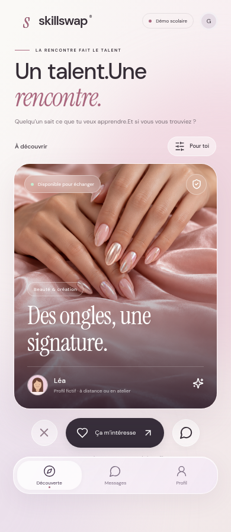

# SkillSwap — prototype scolaire

Document de référence pour reprendre la conception de l’application. Il rassemble les décisions discutées depuis le 12 octobre 2026. La première version web a été autorisée puis réalisée le 14 octobre 2026 avec React, TypeScript et Vite.

## Concept

SkillSwap est une startup fictive créée pour un projet de gestion au lycée. Sa plateforme permet de proposer et de demander des services, de partager ses compétences et d’échanger du temps sans nécessairement payer avec de l’argent.

Exemples : soutien scolaire, langues, aide informatique, montage vidéo, graphisme, couture, cuisine, conseils de CV et autres services quotidiens ou créatifs. Une proposition de service d’ongles a également servi d’exemple visuel pendant la conception.

Le public envisagé est celui des jeunes en général, avec la possibilité d’étendre le concept à tous les publics. La tranche d’âge précise reste à définir.

Les valeurs sont l’entraide, l’accessibilité, la confiance, le partage et l’apprentissage par la pratique.

L’application doit à la fois présenter la startup pour l’école et démontrer l’expérience d’une plateforme d’échange. Une courte présentation du modèle économique est souhaitée ; son contenu reste à définir. Le délai annoncé est de deux semaines à partir de cette discussion.

## Deux modes d’échange

- **Échange direct :** deux personnes conviennent des services qu’elles se rendent mutuellement, par exemple de l’aide en anglais contre du montage vidéo.
- **Crédits fictifs :** une personne gagne des crédits en réalisant un service, puis peut les utiliser auprès d’un autre membre. Il n’est pas nécessaire que les deux personnes s’aident réciproquement.

Le concept initial nomme ces crédits **SkillCoins** ; le nom **LinkCoins** a ensuite été utilisé. Le nom définitif reste à confirmer ; cette première version utilise « points LinkUp », selon la formulation récente du porteur du projet.

La règle « une heure = un crédit » est une possibilité initiale, pas une décision validée. La tarification, les fractions d’heure et les règles de l’échange direct restent ouvertes.

## Annonces et parcours

La personne qui a besoin d’un service publie une annonce précisant :

- le service recherché ;
- le service proposé en échange, s’il y en a un ;
- le temps prévu ;
- la rémunération en crédits fictifs ;
- la plateforme ou le moyen prévu pour communiquer.

Le parcours envisagé : découvrir un profil ou un service, demander ou proposer de l’aide, choisir l’échange direct ou les crédits fictifs, convenir des conditions, puis confirmer la réalisation. Les règles d’acceptation, d’annulation et de confirmation restent à définir.

Une messagerie entre amis inspirée d’Instagram et des appels inspirés de Teams ont été évoqués. Ce sont des possibilités, pas des fonctionnalités validées.

## Organisation de l’application

- **Accueil / Découverte :** la première page permet de parcourir les profils.
- **Découverte :** une section pour parcourir des profils, avec un profil principal à la fois et la possibilité de « matcher » pour échanger des services. La présentation s’inspire des applications de rencontre, mais le match porte sur l’entraide.
- **Profil :** deuxième section, avec présentation, compétences, annonces, personnalisation et points LinkUp.
- **Messages :** conversations autour des services et entre amis. Le premier DM ouvre directement une conversation.
- **Calendrier :** accessible par un bouton discret allongé dans le profil ; panneau presque plein écran sur téléphone et fenêtre centrée sur ordinateur. Il ne constitue pas un onglet supplémentaire.

Une courte présentation du projet et une piste de modèle économique à discuter sont accessibles depuis le profil et le badge « Démo scolaire ».

## Direction artistique

L’ambiance recherchée est claire, aérée, douce, inspirée d’Apple et du glassmorphisme. Les fonctionnalités et leurs interactions doivent être soignées, avec une expérience fluide.

Les références visuelles privilégiées sont :

- des écrans clairs présentant des portraits et des notifications, avec des touches pastel ;
- une composition rose associant verre dépoli, surfaces blanches et noires, grande typographie et boutons arrondis.

Principes envisagés : beaucoup d’espace, hiérarchie lisible, portraits et images mis en valeur, surfaces légèrement transparentes, contours fins, formes arrondies et animations discrètes. Les couleurs exactes, dimensions, bordures et proportions ne sont pas fixées. Le rose sert d’exemple, pas de couleur obligatoire.

Chaque section possède son propre thème, personnalisable selon les souhaits de l’utilisateur. L’étendue de cette personnalisation reste à préciser.

### Ambiance du profil dans la découverte

Le propriétaire choisit et modifie l’ambiance depuis son profil. Elle fonctionne comme une bannière qui se prolonge dans le décor autour de la carte.

Les photos et le background doivent s’accorder. Exemple : des photos roses de réalisations d’ongles accompagnées de quelques touches de rose dans le décor. Les couleurs ne sont pas nécessairement extraites automatiquement : le choix appartient à la personne.

La découverte présente un profil principal entouré de son ambiance. Lorsque l’on passe au profil suivant, le profil et son décor associé changent ensemble.

Les schémas transmis expliquent uniquement ces relations et la hiérarchie du contenu. Ils ne constituent pas des maquettes fidèles : ne pas reprendre leurs rectangles, dimensions, bordures ou positions comme des spécifications définitives. Le comportement du thème de navigation pendant la découverte reste à préciser.

### Carte de profil et reveal

- Une **grande photo principale**, choisie par le propriétaire, domine le recto. Elle peut représenter la personne ou son travail, par exemple une réalisation d’ongles.
- Le recto présente aussi le service et les informations essentielles. Leur disposition exacte reste à concevoir.
- Il est possible de **matcher depuis le recto**. Le contrôle précis reste à définir.
- Le verso révèle les informations supplémentaires. Son contenu exact reste à arrêter.
- **Aucun bouton « Voir les infos ».** Le retournement est déclenché par un glissement du doigt vers la droite (**→**) ou en diagonale vers le haut à droite (**↗**).
- Le passage au profil suivant se fait par un **glissement vers le bas (↓)**.
- L’animation de retournement doit être propre, douce et réactive au geste.

Comportements proposés à préciser lors de la conception : rotation suivant le doigt, seuil de validation du geste, retour à la position initiale si le geste est insuffisant et mouvement inverse pour revenir au recto. La navigation à la souris et au clavier, ainsi que l’alternative avec animations réduites, restent à définir sans remettre en cause le geste principal.

### Fluidité

Limiter les effets de flou coûteux, adapter les images à leur affichage et privilégier des animations courtes. La fluidité devra être vérifiée sur téléphone et ordinateur ; elle ne peut pas être garantie avant implémentation et mesure.

## Cadre du prototype

- Projet scolaire fictif, pas un véritable marché de services.
- Profils et annonces fictifs ; inscription simulée retenue pour la démonstration.
- Aucun paiement réel, transfert d’argent ou système de crédits ayant une valeur réelle.
- Ne pas collecter de véritables informations personnelles sensibles ni exposer d’adresses, de numéros de téléphone ou de coordonnées privées.
- Prévoir des considérations de confiance adaptées au public : signalement, modération et conseils de prudence. Les détails restent à définir ; ne pas prétendre garantir la sécurité.
- Tout objectif de croissance inventé doit être clairement indiqué comme une **projection fictive**.
- Ne pas inventer de statistiques factuelles sur le marché.

## Décisions encore ouvertes

- Nom définitif des crédits : SkillCoins ou LinkCoins.
- Tranche d’âge et langue finale de l’interface ; les échanges de conception sont actuellement en français.
- L’éventuel besoin de sections supplémentaires ; trois onglets sont désormais définis.
- Palettes, décors, logo, typographie et paramètres de personnalisation.
- Contenu détaillé du recto et du verso, contrôle du match et règles qui suivent un match.
- Règles des crédits, durées, annulation et confirmation des services.
- Place de la messagerie, des amis et des appels dans le prototype.
- Fonctions de signalement et de modération à démontrer.
- Présentation du modèle économique.
- Distribution iOS/Android native ultérieure. La première version est web, pensée pour iPhone et utilisable sur ordinateur, avec stockage local sur chaque appareil.

## Reprise et dépôt

Le dépôt GitHub fourni est `Zeboss-pgmg/LinkUp-`. Il doit conserver le futur code pour permettre sa récupération sur le PC du porteur du projet.

À la reprise, lire ce document et les éventuelles instructions du dépôt avant de travailler. Continuer à préciser le produit avec le porteur du projet. Ne pas choisir une technologie ni prendre une décision produit majeure sans lui demander. Le développement de la première version a été explicitement autorisé. Les décisions produit majeures encore ouvertes doivent rester discutées avec le porteur du projet.

Dans les tâches cloud, utiliser le checkout existant : chaque tâche dispose déjà d’un environnement isolé. Ne pas créer de worktree sauf demande explicite.


## Première version — lancement

Prérequis : Node.js 22 ou 24 et npm. Depuis la racine du dépôt :

```sh
npm ci
npm run dev
```

Pour produire la version à héberger :

```sh
npm run build
npm run preview
```

Le dossier `dist/` peut être publié sur un hébergement statique HTTPS. La publication n’est pas réalisée par le simple push GitHub. Sur iPhone : ouvrir l’adresse HTTPS dans Safari, puis Partager → Sur l’écran d’accueil. Il s’agit d’une application web, pas d’une application native ni d’une publication App Store. Pas de fonctionnement hors connexion garanti.

### Fonctionnalités réalisées

- Quatre profils fictifs, ambiances coordonnées et filtres par compétences.
- Geste à droite ou diagonal haut-droite pour retourner la carte ; geste inverse pour le recto ; geste vers le bas pour le profil suivant. Alternative ordinateur : flèches du clavier sur la carte et bouton de profil suivant.
- Signe d’intérêt avec état « en attente » ; la démo ne simule pas une véritable acceptation par un autre utilisateur.
- Conversations locales, sans transmission réseau ni interlocuteur réel.
- Réservation fictive depuis une conversation, choix échange direct ou points, débit simulé, remboursement après annulation et confirmation de réalisation.
- Calendrier d’exemple en octobre 2026, consultable par mois. Les créneaux proposés sont fixes pour la démonstration.
- Modification du profil fictif et quatre ambiances au choix pour le profil et la messagerie. Le choix indépendant de thèmes pour toutes les sections et l’import de bannières restent à développer.
- Signalement simulé, blocage local et conseils de prudence. Aucune modération réelle.
- Données conservées dans le stockage local du navigateur : aucun compte, serveur, paiement ou appel réel. La sauvegarde GitHub conserve le code, pas les conversations locales.

Les noms, compétences et messages sont fictifs. Le visuel d’ongles est généré pour ce prototype ; les autres images et avatars sont des illustrations SVG créées pour le projet. Toutes les images et polices sont livrées localement. Les polices Instrument Serif et DM Sans sont fournies via leurs paquets Fontsource ; leurs licences sont incluses dans ces paquets.

### Vérification

```sh
npm test
```

Les tests Playwright utilisent Chromium installé à `/usr/bin/chromium` dans l’environnement cloud. Sur un autre ordinateur, définir `CHROMIUM_PATH` vers un exécutable Chromium/Chrome, ou adapter `playwright.config.ts` pour utiliser un navigateur Playwright installé. Les captures sont générées dans `test-results/` et ne sont pas versionnées.

La compilation TypeScript et production ainsi que les parcours de découverte, message, réservation, annulation, thèmes et persistance sont vérifiés sous Chromium aux dimensions d’iPhone et d’ordinateur. Un essai sur un véritable iPhone/Safari reste nécessaire pour confirmer les performances et le comportement tactile iOS.

### Aperçus de la première version

[Vue iPhone](docs/apercu-iphone.png) · [Vue ordinateur](docs/apercu-desktop.png)



### Publication GitHub Pages

Une version compilée est préparée sur la branche `gh-pages`. Pour activer l’hébergement : dans Settings → Pages du dépôt, choisir **Deploy from a branch**, branche **gh-pages**, dossier **/(root)**, puis **Save**. GitHub affiche ensuite l’adresse publiée. L’adresse attendue est `https://zeboss-pgmg.github.io/LinkUp-/`, mais elle n’est active qu’après activation et déploiement par GitHub. Les chemins relatifs ont été vérifiés en servant la version compilée sous un sous-dossier.

Après une modification du code, il faudra reconstruire et mettre à jour la branche `gh-pages` ; le push de `main` seul ne met pas à jour cette version statique.

### Déploiement Vercel (option retenue)

Le dépôt contient `vercel.json` avec les paramètres Vite : installation `npm ci`, compilation `npm run build`, sortie `dist/`.

Depuis un compte Vercel, importer `Zeboss-pgmg/LinkUp-` avec l’intégration GitHub et choisir la branche de production `main`, sans sous-dossier racine ni variables secrètes. Autoriser l’accès au dépôt s’il est privé, puis lancer Deploy. Vercel fournit l’adresse HTTPS après le déploiement. Les prochains pushs sur `main` pourront déclencher les mises à jour automatiquement.

Le dépôt et sa configuration sont prêts ; cela ne signifie pas que le projet a déjà été importé ou publié sur Vercel.
